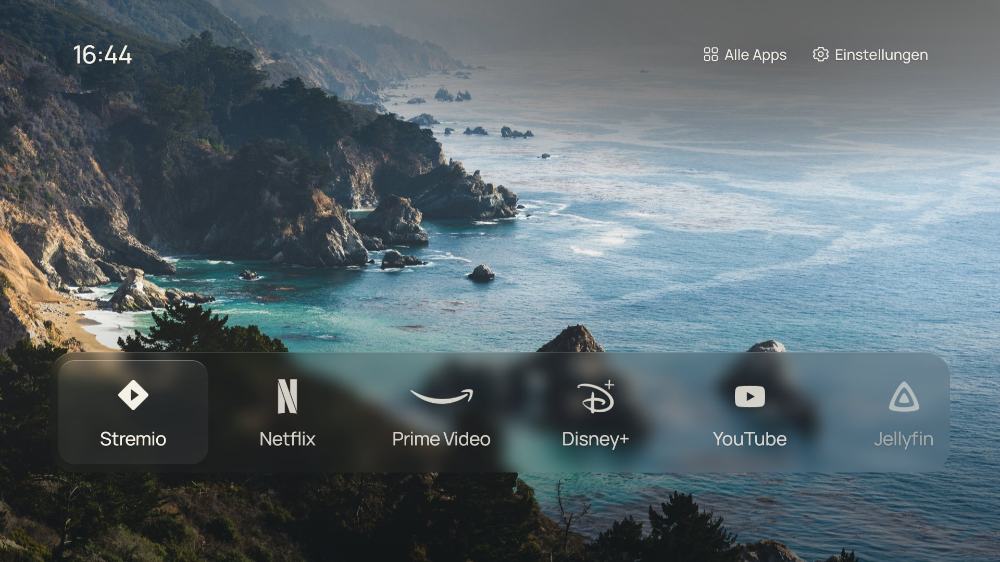
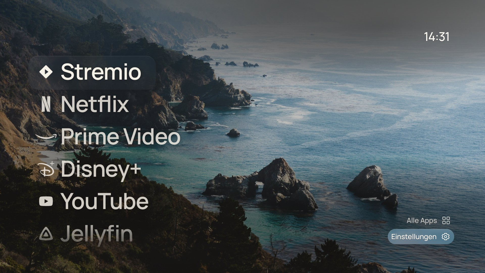
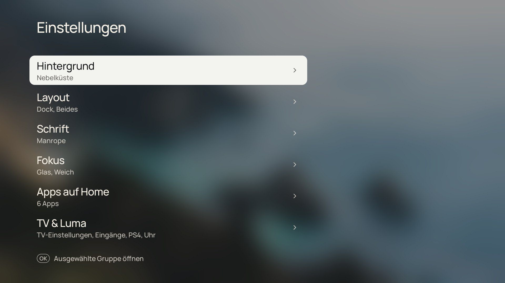
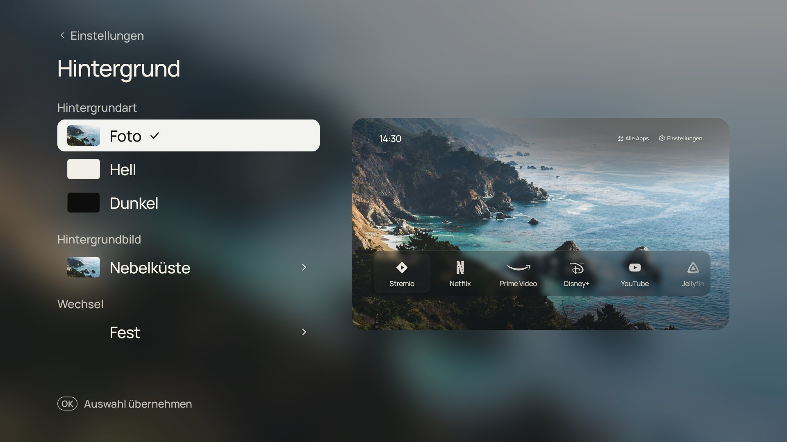
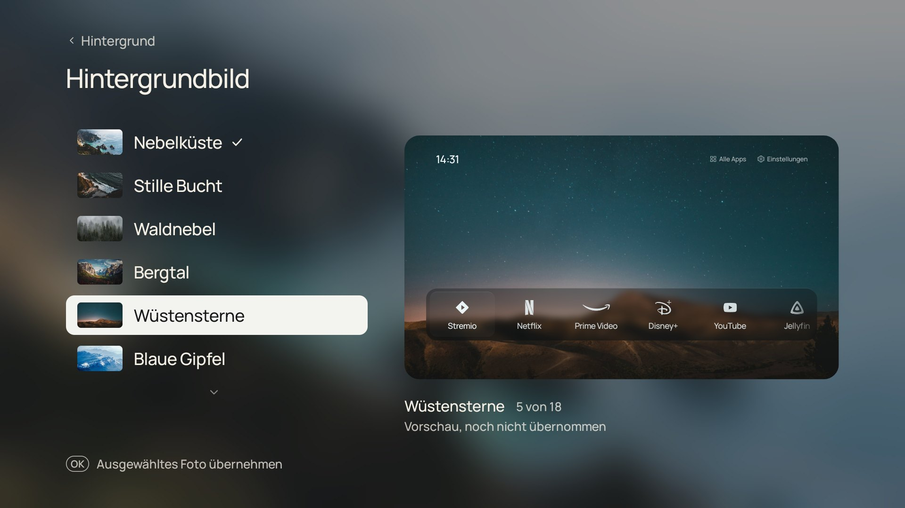
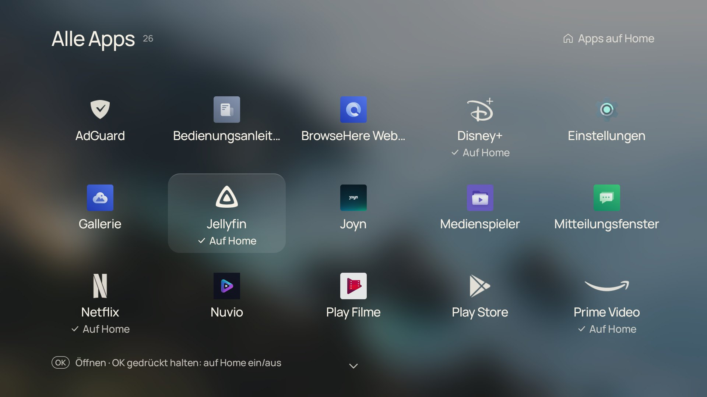
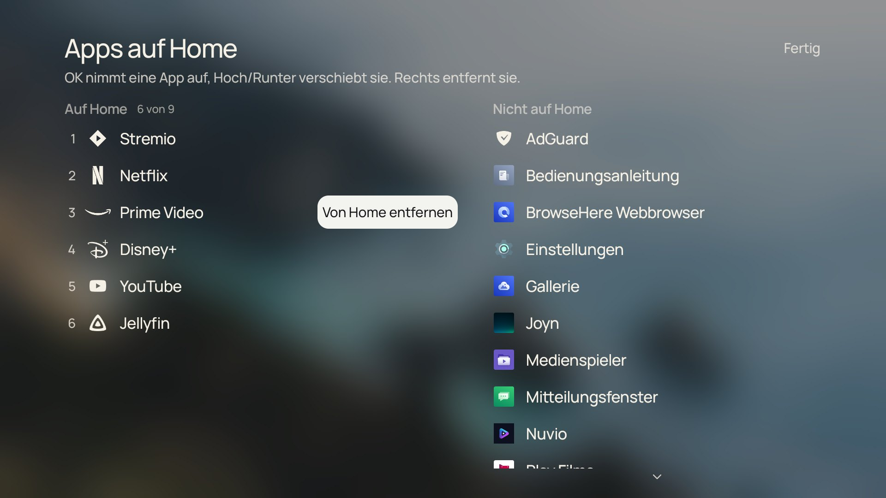

# Luma TV

**Ein ruhiger Foto-Startbildschirm für Android TV und Google TV.** Uhr, ein schönes Foto und deine Apps in einem Glas-Dock. Kein Werbe-Karussell, keine Empfehlungen, keine Hintergrunddienste.

*English: A calm photo home screen (launcher) for Android TV / Google TV with a glass dock or a big-type list, 18 wallpapers and on-screen settings with live preview. Native Java, no libraries. Summary at the end.*



Gestaltung und Bedienung folgen [CleanFrame](https://github.com/nthnclrk/CleanFrame) von Nathan Clark, einem Startbildschirm für Samsung-Fernseher (Tizen). Luma setzt das Design nativ für Android TV um. Die technische Basis (App-Liste, Start, HDMI-Eingänge) stammt aus [TV Detox](https://github.com/Ansub/tv-detox) von Ansub Khan.

## Funktionen

- **Dock oder Liste.** Das Dock zeigt bis zu neun Apps unter Glas, die Liste große App-Namen. Apps und Steuerung jeweils als Text, Icons oder beides.
- **Echtes Glas.** Das Dock zeigt den unscharfen Teil des Fotos, der darunter liegt. Wählbar sind Weich, Frost oder Klar. Die Glasflächen werden einmal pro Foto im Hintergrund berechnet, beim Navigieren wird nichts neu weichgezeichnet.
- **18 Hintergründe:** 15 Fotos (Unsplash) und drei eigene japanisch inspirierte Vektorbilder. Alternativ ein heller oder dunkler Hintergrund. Das Foto kann automatisch wechseln.
- **Einstellungen auf dem Fernseher, mit Live-Vorschau:** Hintergrund, Layout, Schrift (Manrope, Geist, Newsreader), Fokus (Glas oder Schrift), Bewegung, Apps auf Home, TV-Einstellungen, HDMI-Eingänge, Uhrformat, Begrüßung. Nur OK übernimmt eine Einstellung, der Fokus allein ändert nichts.
- **Alle Apps** als Raster. OK öffnet eine App, OK gedrückt halten nimmt sie auf Home oder entfernt sie.
- **Apps auf Home:** Editor mit zwei Spalten zum Sortieren, Hinzufügen und Entfernen.
- **Begrüßung (optional):** „Guten Abend, Hamid“ unter der Uhr, mit eigenem Namen. Standardmäßig aus, einschalten unter Einstellungen › TV & Luma › Begrüßung.
- **Deutsch, Englisch und Russisch**, je nach Systemsprache des Fernsehers.
- **Sichern und Wiederherstellen:** Alle Einstellungen landen als eine Datei auf dem Fernseher (Einstellungen › TV & Luma › Sichern & Wiederherstellen). Mit `adb pull` übersteht sie einen Werksreset oder einen neuen Fernseher, siehe [unten](#einstellungen-sichern).
- **Robust als einziger Startbildschirm:** Startet Luma dreimal hintereinander nicht, kommt ein sicherer Modus ohne Foto statt einer Absturzschleife. Neue, entfernte und auf USB-Speicher liegende Apps erscheinen ohne Neustart, die Uhr folgt Zeitzone und 12/24 h sofort.
- **Für TalkBack lesbar:** Der Bildschirmleser sagt an, was den Fokus hat („Netflix, 2 von 6“).
- **Spielkonsole per HDMI:** Ein Eingang lässt sich als PlayStation zuordnen und erscheint dann im Dock.
- **Klassische Ansicht:** der frühere Kategorien-Startbildschirm im Holzschnitt-Stil ([Details](docs/design-klassisch.md)).
- **Datensparsam:** Kein Internetzugriff, keine Konten, keine Analyse. Einzige Berechtigung ist `ACCESS_NETWORK_STATE`. Alles bleibt lokal auf dem Fernseher.

## Screenshots

Alle Screenshots stammen von einem echten TCL-Fernseher (Android TV 14).

| | |
|---|---|
|  |  |
| Liste mit großen App-Namen | Einstellungen |
|  |  |
| Hintergrund mit Live-Vorschau | Hintergrundbilder |
|  |  |
| Alle Apps | Apps auf Home |

## Installation

Du brauchst ADB (Android Platform Tools) und am Fernseher aktiviertes USB- oder Netzwerk-Debugging.

1. Unter [Releases](../../releases) die APK laden:
   - `luma-tv-…-home.apk` ist der Startbildschirm (mit Home-Filter).
   - `luma-tv-…-preview.apk` ist eine normale App zum Ausprobieren. Sie ändert nichts am Startbildschirm.
2. Installieren:
   ```sh
   adb connect <IP-des-Fernsehers>:5555
   adb install luma-tv-0.4.0-home.apk
   adb shell cmd package set-home-activity --user 0 de.hamid.lumatv/.stage.StageActivity
   ```
3. Home-Taste drücken.

**Update von 0.3:** `adb install -r luma-tv-0.4.0-home.apk`. Die Einstellungen bleiben erhalten, Luma bleibt Startbildschirm. Die Release-APKs sind mit demselben Schlüssel signiert wie 0.3.0; APKs aus den GitHub-Actions-Läufen tragen einen anderen und lassen sich nur nach einer Deinstallation installieren.

### Einstellungen sichern

Unter Einstellungen › TV & Luma › Sichern & Wiederherstellen schreibt „Jetzt sichern“ die Datei `luma-settings.json` in Lumas App-Ordner. Vor einem Werksreset oder einer Neuinstallation abholen und danach zurücklegen:

```sh
adb pull /sdcard/Android/data/de.hamid.lumatv/files/luma-settings.json
adb push luma-settings.json /sdcard/Android/data/de.hamid.lumatv/files/
```

Danach „Wiederherstellen“ wählen. Eine kaputte oder fremde Datei ändert nichts.

> **Hinweis zu Google TV:** Auf Google-TV-Geräten übernimmt der Google-TV-Startbildschirm die Home-Taste meist trotzdem. Auf dem Testgerät wurde Luma erst zuverlässig zum Startbildschirm, nachdem der Google-TV-Launcher für den Benutzer entfernt (`pm uninstall --user 0 com.google.android.apps.tv.launcherx`) und der Einrichtungsassistent deaktiviert wurde (`pm disable-user --user 0 com.google.android.tungsten.setupwraith`). Das greift ins System ein. Mach das nur, wenn du den Rückweg kennst:
>
> ```sh
> adb shell cmd package install-existing --user 0 com.google.android.apps.tv.launcherx
> adb shell pm default-state --user 0 com.google.android.tungsten.setupwraith
> adb shell cmd package set-home-activity --user 0 com.google.android.apps.tv.launcherx/.home.HomeActivity
> ```
>
> Ohne Gewähr. Ein Werksreset stellt ebenfalls alles her, löscht aber alle Daten am Fernseher.

## Bedienung

| Taste | Startbildschirm |
|---|---|
| Links/Rechts (Dock) oder Hoch/Runter (Liste) | App wählen |
| Hoch (Dock) oder Rechts (Liste) | zu „Alle Apps“ und „Einstellungen“ |
| OK | App öffnen |
| OK gedrückt halten oder Menü | Home-Editor bei dieser App öffnen |
| Zurück | schließt eine Ebene nach der anderen |

## Bauen

JDK 17, Android SDK Platform 34. Gradle 8.9 und AGP 8.7.3 sind fest eingestellt. Keine Laufzeitbibliotheken.

```sh
./gradlew :app:assembleHomeDebug :app:assemblePreviewDebug
./gradlew :app:testHomeDebugUnitTest      # Tests, dazu Bildschirmfotos in app/build/screenshots
```

Die Tests laufen mit Robolectric auf der JVM (nur Testabhängigkeiten, die APK bleibt ohne Bibliotheken). `StageScreenshotTest` zeichnet Home, Einstellungen, Alle Apps und den Editor in 1920×1080 auf Deutsch, Englisch und Russisch, damit sich Designänderungen ohne Fernseher prüfen lassen.

GitHub Actions baut beide Varianten bei jedem Push auf `main` und bei jedem Pull Request, führt die Tests aus und prüft die Grundsätze: keine INTERNET-Berechtigung, keine Laufzeitbibliotheken. APKs, Bildschirmfotos und Berichte liegen als Artefakte am jeweiligen Lauf.

**Release-Signatur:** `assembleHomeRelease` signiert mit dem Schlüssel aus den Umgebungsvariablen `LUMA_STORE_FILE`, `LUMA_STORE_PASSWORD`, `LUMA_KEY_ALIAS` und `LUMA_KEY_PASSWORD` (oder gleichnamigen Gradle-Properties `luma.*`). Ohne diese Angaben wird mit dem lokalen Debug-Schlüssel signiert, wie bei 0.3.0. Ein Schlüssel gehört nie ins Repository.

| Variante | Paket | Zweck |
|---|---|---|
| `home` | `de.hamid.lumatv` | Startbildschirm mit Home-Filter |
| `preview` | `de.hamid.lumatv.preview` | normale App zum Testen |

## Projektaufbau

```text
app/src/main/java/de/hamid/lumatv/
  stage/     Startbildschirm ab 0.3: StageActivity, StageView (Fokus, Tasten, Bildschirme),
             HomePainter (Dock, Liste), SheetPainter (Einstellungen, Alle Apps, Editor),
             Scene (Foto und Glas), Walls (Galerie), Marks (Icons), Type (Schriften), Look,
             SafeStart (Schutz vor Absturzschleifen), Greeting
  data/      Sicherung der Einstellungen (SettingsBackup), Verlauf, klassische Konfiguration
  ui/        klassische Ansicht (0.2)
  platform/  App-Katalog, App-Start, HDMI-Eingänge, Einstellungen
app/src/main/assets/   Fotos (1920×1080) und variable Schriften
tools/icons/           SVG → Android-Vektor, Messung der Icon-Maße
tools/wallpapers/      Generator der Vektor-Hintergründe
```

Die ganze Oberfläche zeichnet ein einziger Canvas-View auf einer 1920×1080-Bühne, mit denselben Maßen wie CleanFrame. Die Animationen (180 ms, cubic-bezier(.2, .7, .2, 1)) laufen über eine eigene Uhr. Sie funktionieren deshalb auch, wenn die Systemanimationen ausgeschaltet sind, und lassen sich in den Einstellungen abschalten.

## Getestet

TCL Smart TV Pro, Android TV 14 (Google TV), Oberfläche 1920×1080:

- Kaltstart 1,1 bis 2,1 s.
- Navigation im Dock: Median 14 ms pro Bild, 2,2 % verspätete Bilder.
- Arbeitsspeicher direkt nach dem Start rund 59 MB PSS.

Andere Geräte sind nicht getestet.

## Credits und Lizenzen

- Code: MIT, siehe [LICENSE](LICENSE). Enthält Teile von TV Detox (MIT, Ansub Khan). Design und Verhalten nach CleanFrame (MIT, Nathan Clark). Begrüßung, russische Übersetzung und Build-Workflow aus dem Fork [Horizon Home](https://github.com/danilll0001/luma-tv) (MIT, danilll0001).
- Fotos: Unsplash-Lizenz. Fotografen und Links stehen in [NOTICE.md](NOTICE.md).
- Schriften: Manrope, Geist, Newsreader, Shippori Mincho (SIL OFL 1.1).
- Marken-Icons: Simple Icons (CC0), Disney+ aus Custom Brand Icons (MIT). Die Marken gehören ihren Inhabern und kennzeichnen nur die jeweils installierte App. Dieses Projekt steht in keiner Verbindung zu den Anbietern, zu TCL, Google oder Samsung.

Alle Lizenztexte liegen in [`third-party/`](third-party/).

## English summary

Luma TV is a home screen (launcher) for Android TV / Google TV, built natively in Java with no runtime libraries. It ports the look and behaviour of [CleanFrame](https://github.com/nthnclrk/CleanFrame), a Samsung Tizen home screen by Nathan Clark, and features:

- a glass dock or a big-type list;
- 15 Unsplash photos plus three original vector wallpapers;
- live-preview settings, an All apps grid and a two-column Home editor;
- a local settings backup file, a safe mode instead of a crash loop, and TalkBack focus announcements;
- an optional greeting with your name under the clock (off by default);
- HDMI console shortcuts.

It needs no internet permission and stores everything locally. Install the APK from Releases with `adb`. On Google TV devices the stock launcher may keep the Home key; see the note above, including how to revert. Tested on a TCL Smart TV Pro (Android TV 14). The UI is German, English and Russian.
